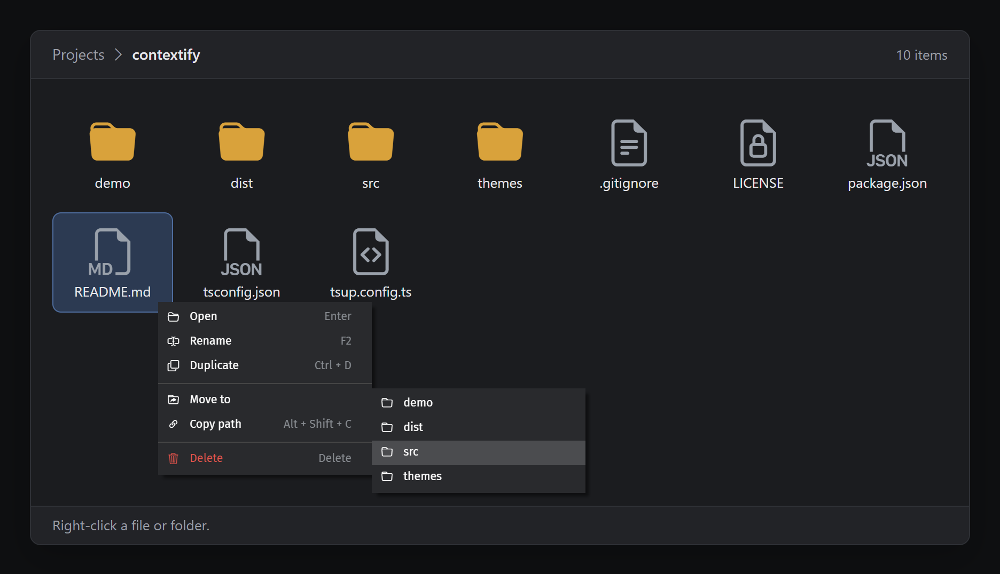
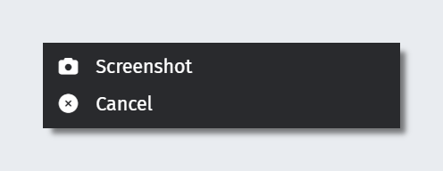
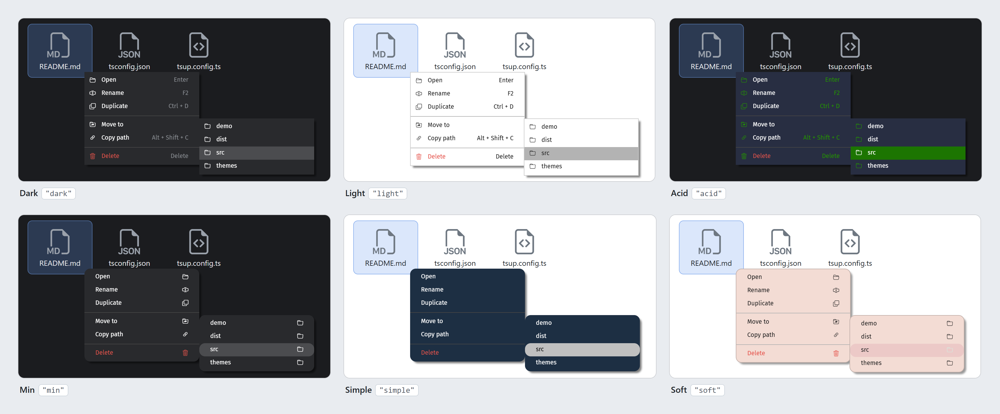
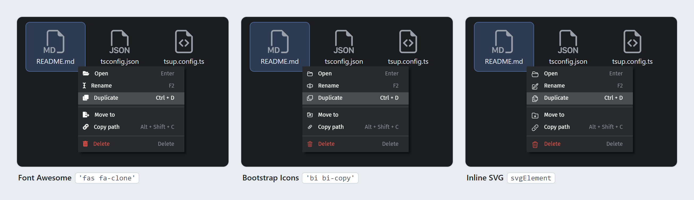
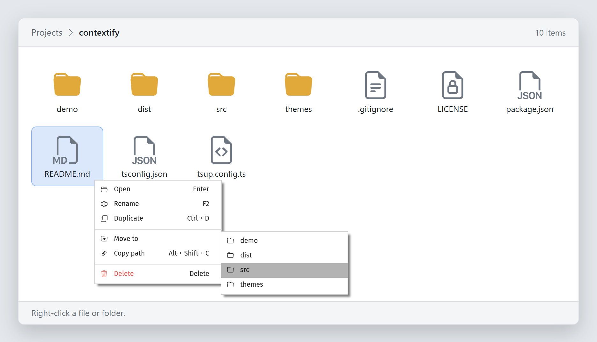

<h1 align="center">Contextify</h1>

<p align="center">
 <a href="https://www.npmjs.com/package/@jacoobia/contextify"></a>
 <a href="https://www.npmjs.com/package/@jacoobia/contextify"></a>
</p>

2026 - I finally got bored enough to update this little project. This project is now an ES module, rewritten in TypeScript, providing its own types and published to npm as @jacoobia/contextify. As before, I won't maintain this actively, just whenever I feel like it. Feel free to contribute

A lightweight context menu library with support for any icon library. <br/>
This library was written for use in a personal project of mine as an AIO solution for the features of a context menu that I wanted that I could only find spread across multiple different context menu libraries. This is very early doors and I will continue to maintain this however slowly that may be as I build my personal projects and use cases change or the need for features arise.



## Install

```sh
npm install @jacoobia/contextify
```

```js
import Contextify from '@jacoobia/contextify';
```

Or without a bundler:

```html
<script src="https://unpkg.com/@jacoobia/contextify/dist/contextify.global.js"></script>
```

| Build | File | Size |
| --- | --- | --- |
| ES module | `dist/contextify.js` | |
| CommonJS | `dist/contextify.cjs` | |
| Browser global | `dist/contextify.global.js` | 7.8 KB minified, 2.8 KB gzipped |
| Types | `dist/contextify.d.ts` | |

No runtime dependencies.

## Usage

```js
//Construct our menu buttons 
const menuButtons = [
    { icon: 'fa-solid fa-camera', type: 'button', text: 'Screenshot', click: screenshot },
    { icon: 'fa-solid fa-times-circle', type: 'button', text: 'Cancel', click: (event) => { menu.hide(false); }}
];
//Create our new Contextify object with the buttons, theme, container
const menu = new Contextify(menuButtons, "dark", document.body);
```

Which creates the following menu (note, the example requires you to have a form of FontAwesome installed):



## Options

```js
new Contextify(buttons, theme, container?, alignment?, themePath?)
```

| Argument | Default | Description |
| --- | --- | --- |
| `buttons` | | Array of button definitions (see below). |
| `theme` | | Theme name, e.g. `"dark"` loads `contextify-dark.css`. |
| `container` | `document.body` | Element the menu is attached to and listens on. |
| `alignment` | `'south-east'` | Which way the menu opens from the cursor: `'north-west'`, `'north-east'`, `'south-west'` or `'south-east'`. |
| `themePath` | `'themes/'` | Folder the theme CSS is loaded from, relative to the page. See [Themes](#themes). |

### Buttons

| Property | Description |
| --- | --- |
| `text` | Label shown on the button. |
| `type` | `'button'` (default) or `'separator'`. |
| `icon` | Icon class names (`'bi bi-camera'`) or an Element such as an inline SVG. |
| `click` | Called with `{ button, parent, handled, hotkey }` when the button is clicked or its hotkey is pressed. |
| `hotkey` | Keyboard shortcut that fires `click`, e.g. `'Ctrl + Shift + S'`. Modifiers: `Ctrl`, `Alt`, `Shift`, `Meta`/`Cmd`. |
| `hotkeyLabel` | Shortcut text shown on the button. Defaults to `hotkey`. A string without `hotkey` shows a shortcut your app already handles; `false` hides the label. |
| `requireMenuOpen` | `false` by default, so hotkeys work any time. `true` only fires the hotkey while the menu is open. |
| `enabled` | `false` greys the button out and disables its hotkey. |
| `colour` / `textcolour` | Background / text colour as `'r:g:b:a'`, e.g. `'255:0:0:1'`. |
| `child` | Array of buttons to show as a submenu. |

### Methods

| Method | Description |
| --- | --- |
| `show(x, y)` | Opens the menu at viewport coordinates. |
| `hide(hideParent?)` | Closes the menu and its submenus. |
| `assignTheme(theme, themePath?)` | Swaps the theme stylesheet. |
| `enableButton(selector)` / `disableButton(selector)` | Toggles the `enabled` / `disabled` class on a rendered button, e.g. `'#Rename'`. |
| `register()` / `deregister()` | Adds / removes the menu's event listeners, including submenus. |

## Hotkeys

- Hotkeys fire while focus is inside the container, or at any time while the menu is open.
- While typing in a text field, only hotkeys using `Ctrl`, `Alt` or `Meta` fire.
- `event.hotkey` is the shortcut that fired `click`, or `undefined` for a mouse click.
- When a hotkey fires while the menu is closed, `event.button` is `null` because no menu entry is rendered.
- To hide every shortcut label: `.context .hotkey { display: none; }`

```js
click: (event) => {
    if (event.hotkey === undefined) event.button.classList.add('used'); // mouse click, button is always set
}
```

## Themes



Themes are stylesheets loaded at runtime from `themePath`. The default `'themes/'` is relative to the page, so either:

- load them from a CDN:

```js
new Contextify(buttons, 'dark', document.body, 'south-east', 'https://unpkg.com/@jacoobia/contextify@2/themes/');
```

- or copy `node_modules/@jacoobia/contextify/themes/` into the folder your site serves, and keep the default or point `themePath` at it.

| Theme | Menu colour | Corners | Icons | Shortcuts |
| --- | --- | --- | --- | --- |
| `dark` | `#292A2D` | Square | Left | Shown |
| `light` | `#FFFFFF`, bordered | Square | Left | Shown |
| `acid` | `#282E42`, green accents | Square | Left | Shown |
| `min` | `#292A2D` | Rounded | Right | Hidden |
| `simple` | `#1D2F43` | Rounded | Hidden | Hidden |
| `soft` | `#F3DCD4`, bordered | Rounded | Right | Hidden |

Custom theme: copy a file from `themes/` to `contextify-{name}.css` in your `themePath` folder and pass `"{name}"` as the theme.

## Icons



```js
{ icon: 'fa-solid fa-camera', text: 'Screenshot' }      // FontAwesome
{ icon: 'bi bi-camera', text: 'Screenshot' }            // Bootstrap Icons
{ icon: mySvgElement, text: 'Screenshot' }              // any Element, cloned into the menu
```

## TypeScript

Types ship with the package:

```ts
import Contextify, { type ContextifyButton, type ContextifyClickEvent, type Alignment } from '@jacoobia/contextify';
```

## Demos

| File | Shows |
| --- | --- |
| `demo/showcase.html` | A file manager with working actions and hotkeys. |

Build first (`npm run build`), then open it directly in a browser.



## Contributing

<!-- Your words: how you'd like people to contribute, where to report bugs, what a good PR looks like. See Contextify-readme-talking-points.txt. -->

```sh
git clone https://github.com/jacoobia/Contextify.git
cd Contextify
npm install
npm run build
```

```
src/contextify.ts   the library (single file)
themes/             theme stylesheets
demo/               demo pages (open from disk after building)
media/              README images
dist/               build output (git-ignored)
```

## License

MIT, see [LICENSE](LICENSE).

---

Disclaimer: This has only been tested on desktop, MacOS and Windows 10. I have not tested this on any mobile devices.
